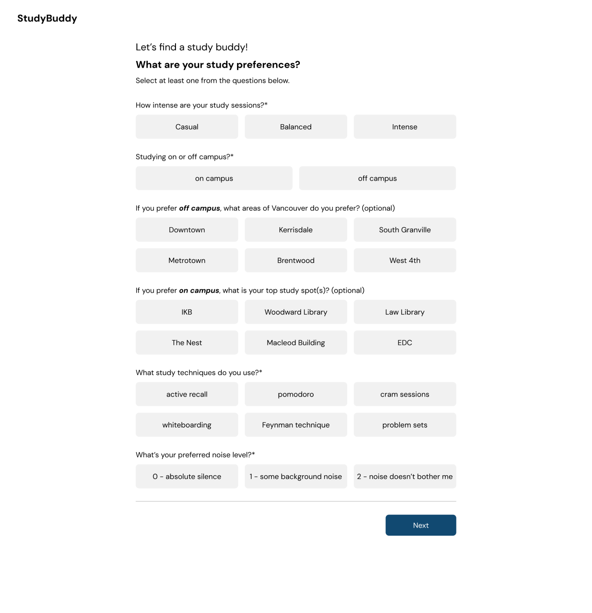
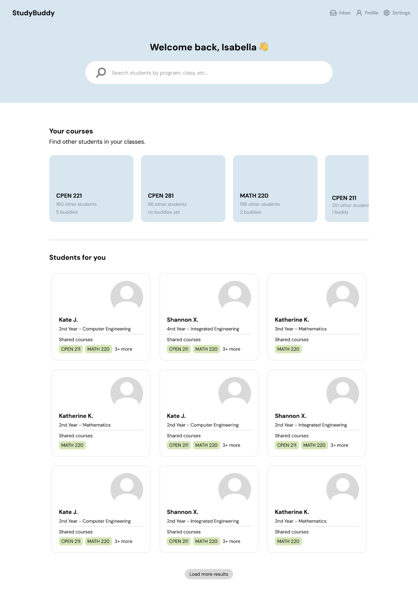
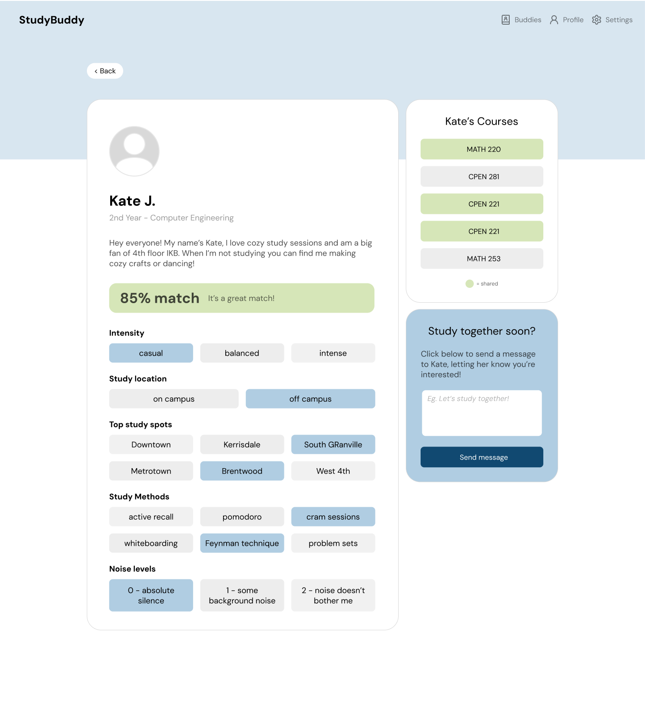
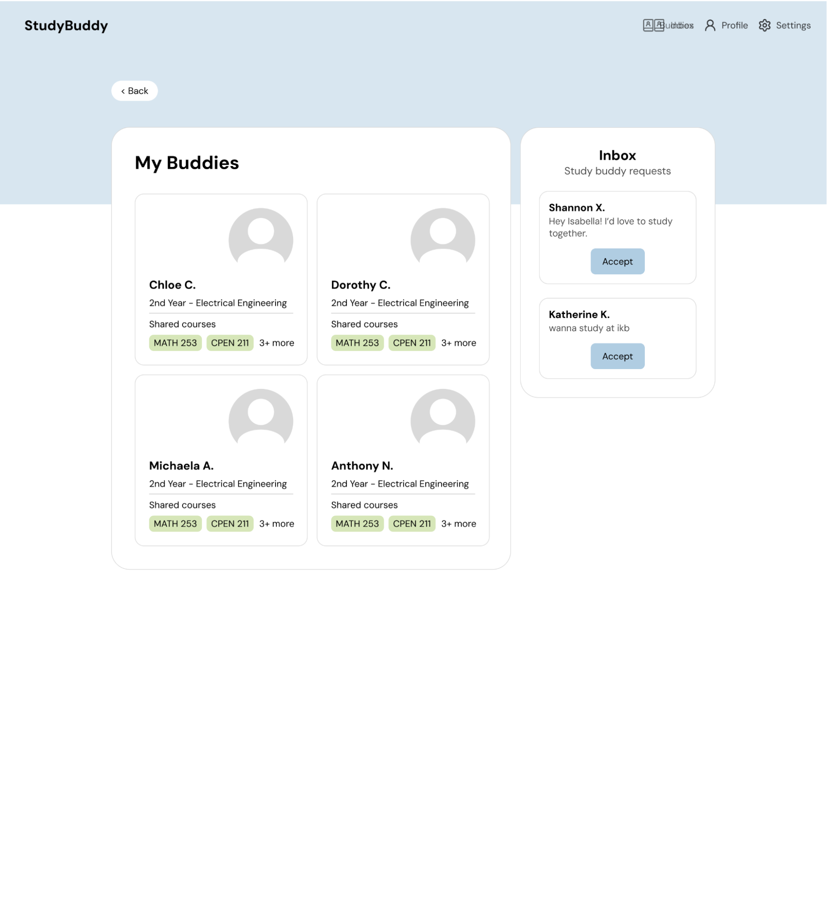

# Specification: Study Buddies
## Problem
Students at UBC have no means to connect and study together, and as a result, they often study alone. According to Hammar Chirac (2014), however, 97% of the students surveyed said that group studying was more effective at facilitating learning. While some online platforms do exist with the purpose of connecting students, they are either poorly made or aren't tailored to life at UBC; for example, the website meetyourclass.com only has around 120 members from UBC. This ultimately prevents users from properly connecting with their peers. 

Without academic connection, students' grades may suffer. However, community engagement can also affect mental resiliency and overall quality of life (Magomedova, 2025). This issue particularly affects newer students, who may struggle to meet others that they can study with. Our preliminary user research suggests that first- and second-year students would be interested in testing the platform. 

### References
Hammar Chiriac E. (2014). Group work as an incentive for learning - students' experiences of group work. Frontiers in Psychology, 5, 558. https://doi.org/10.3389/fpsyg.2014.00558 

Magomedova, A., & Fatima, G. (2025). Mental Health and Well-Being in the Modern Era: A Comprehensive Review of Challenges and Interventions. Cureus, 17(1), e77683. https://doi.org/10.7759/cureus.77683

## Solution
We imagine a web app where UBC students can find other students to study with in person. Instead of matching you with one person, it works like a catalogue. You browse many classmates/courses at once and can connect with as many as you like.

To sign up, students use their UBC email. The email must end in @student.ubc.ca. Error Handling: If an invalid email format or non-UBC domain is entered, an error banner displays: "Please enter a valid @student.ubc.ca email address." They then set up a short study profile: their program and year, their courses (we will pre-select the usual courses for their major and year, and they can add or remove any), when they're usually free, how they like to study (casual or intense, quiet or background noise, in pairs or groups), their favourite study spots, whether they live on or off campus, a short bio, and the contact info they want to share. They can view the landing page but can't continue until they sign up.

### Crucial Onboarding Data
- on/off campus preferred (ask about preferred locations)
- study intensity (casual, balanced, intense)
- noise level (0 - absolute silence, 1, 2 - noise doesn't bother me)
- classes (fill in)
- ideal study times
- study techniques (deep focus, pomodoro, cram sessions, whiteboarding, quiet company, social/casual)

The home page works like a landing page. A search and filter bar at the top searches courses, exams and students, and the filters narrow results by things like course, study style and free days. Below it is a row of upcoming exams and midterms in the student's courses that scrolls sideways. Next is a grid of courses, with dropdowns to choose a major and year level. Tapping an exam or course shows every student in that course. Empty State: If search or filtering yields no results, the screen displays: "No study partners found matching your filters. Try adjusting your criteria."

### Compatibility Algorithm
 
Each student is compared with every other student using a match score out of 100, built from their onboarding answers. Shared classes and free time are worth the most, since you can't study together without them.

| Category | Criteria | Max |
|---|---|---|
| Shared classes | 6 points per class (up to 5 classes) | 30 |
| Free time | 2 points per hour you're both free in a week (up to 10hr) | 20 |
| Intensity (3 levels) | Same: 12. One step apart (e.g. casual vs balanced): 6. Casual vs intense: 0 | 12 |
| Noise level (0–2) | Same: 12. One apart: 6. Two apart: 0 | 12 |
| Study methods (6 options) | 4 points per method you both picked (up to 3) | 12 |
| Study location | Both on campus or both off campus: 6 | 6 |
| Top study spots (6 options) | 4 points per spot you both picked (up to 2) | 8 |
| **Total** | | **100** |

The score is the same in both directions: A's match with B equals B's match with A. It's recalculated whenever either student edits their profile. When you open a course or exam, the students in it are listed from highest match % to lowest.

*Example:* Two students share 3 classes (18) and 4 free hours (8). One is casual and the other is balanced (6). Both study off campus (6) and both picked Brentwood (4). Both use cram sessions and the Feynman technique (8). Their noise levels are 0 and 1 (6). Their match is **56%**.

Tapping a student opens their profile, which shows their courses, study style, and the times you're both free. It also shows a match percentage based on how many courses, free hours and study preferences you share. Their contact info stays hidden unless they also match (explained below).

If a student wants to study with someone, they tap Interested, which works like sending a "like". The other person can see who's interested in them. If they tap Interested back, it's a match and both students see a pop-up and can now see each other's contact info to plan a study session. A student can take back their interest any time before a match, or hide someone so they never see each other.

A Connections page lists your matches with their contact info, the people interested in you, and the people you've sent interest to.

Features we'll add if we have time include a small in-app messaging system, integration with Google Calendar, and a study log/review of past sessions. The app works on phones and laptops with the same layout. Laptops just show more cards per row.
